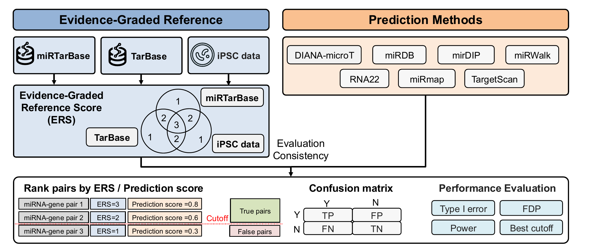

# Benchmarking miRNA Target Prediction Methods

## Citation

If you use this code, please cite our paper:

> Benchmarking miRNA Target Prediction Methods. Submitted to IEEE BIBM 2026 (under review).
> The full citation will be added after publication.

## Contents

* [Overview](#overview)
* [Repo Contents](#repo-contents)
* [Data](#data)
* [Analysis Folder Guide](#analysis-folder-guide)
* [Figures](#figures)
* [System Requirements](#system-requirements)
* [Installation Guide](#installation-guide)
* [License](#license)

## Overview

This study benchmarks seven widely used miRNA target prediction tools (TargetScan, miRDB,
miRmap, DIANA-microT, RNA22, miRWalk and mirDIP) against a graded reference. Every candidate
miRNA-gene pair receives a reference score from 0 to 3, one point each for support in
miRTarBase, in TarBase and in an internal iPSC miRNA-mRNA expression dataset. Each tool's
predictions are compared with the reference through a confusion matrix over all
59,734,204 candidate pairs, giving the Type I error rate, power and false discovery
proportion as the reference evidence and the tool's prediction threshold vary.



*Figure 1. Study design.*

## Repo Contents

```
├── analysis/                                  # End-to-end workflow (Python)
│   ├── 01_generate_input_sets.py              # Reference sets from the raw files
│   ├── 02_build_ref_score_table.py
│   ├── 03_compute_confusion_metrics.py
│   ├── checks/
│   │   └── verify_ref_table.py                # Independent check of step 02
│   └── results/                               # refscore_metrics.csv, refscore_best_cutoff.csv
├── figure/                                    # Figure scripts and outputs
│   ├── Fig1/                                  # Study design (Fig1.png)
│   └── Fig2/ – Fig5/                          # FigN.py and results/figN.pdf
├── data/                                      # Input files (not tracked; see data/README.md)
├── requirements.txt
└── LICENSE
```

All scripts are run from the repository root, for example `python figure/Fig3/Fig3.py`.
Each script starts with a header that lists its inputs, outputs and prerequisite step.

## Data

| Source | Version | Citation |
|--------|---------|----------|
| miRTarBase | miRTarBase 2025 (`hsa_MTI.csv`) | Cui S. et al., *Nucleic Acids Res.* 53(D1):D147–D156, 2025 |
| TarBase | TarBase v9.0 (`Homo_sapiens_TarBase-v9.tsv`) | Skoufos G. et al., *Nucleic Acids Res.* 52(D1):D304–D310, 2024 |
| iPSC dataset | internal bulk RNA-seq and mature miRNA counts, 10 donors × 2 replicates | this study; not included in the repository |
| Prediction tools | TargetScan v8.0, miRDB v6.0, miRmap, DIANA-microT, RNA22, miRWalk, mirDIP v5.2 | see `data/README.md` |

The input data are not tracked. `data/README.md` lists every file, its columns and where it is placed.

## Analysis Folder Guide

The `analysis/` directory builds the reference and evaluates the tools.

| Script | Description |
|--------|-------------|
| `01_generate_input_sets.py` | Reads the three reference sources from their raw files. miRTarBase (Non-Functional MTI and non-human records removed) and TarBase (all 4,724,537 records; 1,311,328 unique pairs) are collapsed to unique miRNA–gene pairs and merged; iPSC negative-correlation pairs (Pearson r < −0.2, BH FDR < 0.05, 20 samples); the score-0 set of all other pairs with a defined correlation |
| `02_build_ref_score_table.py` | One row per candidate pair (2,036 miRNAs × 29,339 genes = 59,734,204 pairs) with the three reference flags, the reference score and the strongest score of each tool |
| `03_compute_confusion_metrics.py` | Confusion matrix of each tool for truth = reference score ≥ c (c = 1, 2, 3) and prediction = top 10%, 20%, …, 100% of the tool's ranked predictions; FDP, Type I / Type II error, Youden's J and the J-maximising cutoff |
| `checks/verify_ref_table.py` | Recomputes every column of the reference table from the input files with independent code and compares pair by pair |

Run scripts in numbered order (`01` → `02` → `03`).
All three steps and the check need about 64 GB of memory; they were run on a SLURM compute node.

### Reference counts

| Reference score | Pairs |
|-----------------|-------|
| 3 | 1,683 |
| 2 | 110,890 |
| 1 | 2,252,524 |
| 0 | 57,369,107 |

## Figures

The tracked files `analysis/results/refscore_metrics.csv` and `figure/Fig2/results/fig2_curve_data.json`
are enough to redraw every figure below without the input data. The values of Table II (error rates
at the Youden-optimal cutoff of each tool, truth = reference score ≥ 1) are the `truth_cutoff = 1`
rows of `analysis/results/refscore_best_cutoff.csv`.

### Main Figures

- **[Figure 1: Study design](figure/Fig1/Fig1.png)**
- **[Figure 2: Reference datasets and tool coverage](figure/Fig2/results/fig2.pdf)** (code: [Fig2.py](figure/Fig2/Fig2.py))
- **[Figure 3: Type I error rate](figure/Fig3/results/fig3.pdf)** (code: [Fig3.py](figure/Fig3/Fig3.py))
- **[Figure 4: Power](figure/Fig4/results/fig4.pdf)** (code: [Fig4.py](figure/Fig4/Fig4.py))
- **[Figure 5: False discovery proportion](figure/Fig5/results/fig5.pdf)** (code: [Fig5.py](figure/Fig5/Fig5.py))

### Definitions

* **Truth** at cutoff c: reference score ≥ c. Score-0 pairs are negatives at every cutoff.
* **Prediction**: the top X% of a tool's own ranked predictions, ties at the threshold included;
  pairs a tool does not score count as not predicted. When a tool lists several rows for one
  pair, the strongest score is kept (minimum for TargetScan, miRmap and RNA22, maximum otherwise).
* **Metrics**: Type I error = FP / (FP + TN); power = 1 − Type II error = TP / (TP + FN);
  FDP = FP / (TP + FP); Youden's J = sensitivity + specificity − 1.
* **Baselines**: Type I error 0.05; power 0.80; FDP 0.96 (the FDP of random predictions, i.e. the
  share of score-0 pairs among all candidate pairs).

## System Requirements

### Hardware Requirements

* Figures and tables (`figure/`): a standard computer, 4+ GB RAM.
* Reference sets, reference table and metrics (`analysis/`): about 64 GB RAM; these steps were run
  on a SLURM compute node.

### Software Requirements

#### OS Requirements

The code has been run on:
- Linux (SLURM cluster)
- macOS

#### Python and Package Requirements

**Python version:** Python 3.9 or higher (the checks in this repository used Python 3.13)

| Package | Used by | Version used for the checks in this repository |
|---------|---------|-----|
| numpy | all | 2.5.3 |
| pandas (≥ 1.3) | all | 3.0.5 |
| matplotlib (≥ 3.4) | figures | 3.11.2 |
| pyarrow | `01`, `02`, check | 25.0.1 |
| scipy (≥ 1.11) | `01` | 1.18.1 |

Figures use Arial when it is installed, otherwise Liberation Sans or DejaVu Sans.

## Installation Guide

```bash
git clone https://github.com/congliangjin141-coder/miRNA_target_prediction.git
cd miRNA_target_prediction
conda create -n mirna python=3.11
conda activate mirna
pip install -r requirements.txt
```

Then redraw the figures from the tracked results:

```bash
python figure/Fig2/Fig2.py
python figure/Fig3/Fig3.py
python figure/Fig4/Fig4.py
python figure/Fig5/Fig5.py
```

## License

See [LICENSE](LICENSE) file for details.
